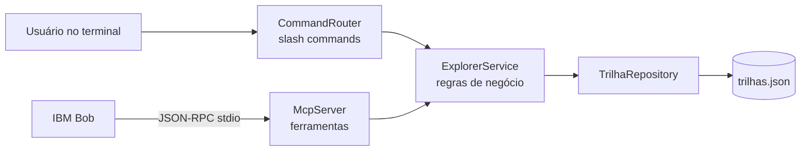

# 🧭 Geo-Explorer

Explorador interativo de trilhas de aprendizagem, construído em parceria com o **IBM Bob** no desafio *Construindo Seu Primeiro Produto com um Agente de IA* (DIO + IBM).

O Geo-Explorer consulta uma base fictícia de trilhas, sorteia desafios práticos, gera flash cards e emite certificados. Ele funciona de dois jeitos, com a mesma regra de negócio por trás:

- **CLI com slash commands** (`/trilha`, `/desafio`, `/certificado`, `/cards`, `/help`)
- **Servidor MCP** via stdio, para o IBM Bob (ou outro cliente MCP) usar as mesmas funções como ferramentas

   

---

## Sumário

1. [Como rodar](#como-rodar)
2. [Comandos](#comandos)
3. [Servidor MCP](#servidor-mcp)
4. [Arquitetura e decisões](#arquitetura-e-decisões)
5. [Padrões de código](#padrões-de-código)
6. [Como o IBM Bob foi usado](#como-o-ibm-bob-foi-usado)
7. [Prompts em pontos críticos](#prompts-em-pontos-críticos)
8. [Intervenção humana](#intervenção-humana)
9. [Métricas do Bobalytics](#métricas-do-bobalytics)
10. [Testes](#testes)
11. [Aprendizados](#aprendizados)

---

## Como rodar

**Requisito:** JDK 25 (`java -version`). O Maven é opcional.

### Windows (PowerShell, sem Maven)

```powershell
powershell -ExecutionPolicy Bypass -File .\build.ps1      # compila e gera target/geo-explorer.jar
.\run.ps1                                                  # modo interativo
.\run.ps1 /trilha java                                     # um comando e sai
.\run.ps1 /certificado "Seu Nome" java                     # salva em output/
powershell -ExecutionPolicy Bypass -File .\test.ps1       # roda os testes JUnit 5
```

### Com Maven

```bash
mvn test                       # 38 testes
mvn package                    # gera target/geo-explorer.jar
java -jar target/geo-explorer.jar /help
```

### Linux / macOS / Git Bash (sem Maven)

```bash
./build.sh
java -jar target/geo-explorer.jar /help
```

---

## Comandos

| Comando | O que faz |
|---|---|
| `/trilha <tecnologia>` | Plano de estudos com módulos, tópicos (checklist), carga horária e XP |
| `/desafio <tecnologia> [iniciante\|intermediario\|avancado]` | Sorteia um desafio prático; sem nível, o nível também é sorteado |
| `/certificado "<nome>" <tecnologia>` | Gera certificado em Markdown com código de verificação e salva em `output/` |
| `/cards <tecnologia> [quantidade] [categoria]` | Flash cards de revisão (padrão 3, máximo 20) |
| `/help` | Lista comandos e tecnologias |

Tecnologias: `java`, `python`, `javascript` (aliases `js`, `node`), `react`, `sql`. A busca ignora maiúsculas e acentos e sugere a opção mais parecida quando há erro de digitação:

```text
geo> /trilha pyton
Erro: Tecnologia 'pyton' não encontrada. Você quis dizer 'python'? Disponíveis: java, javascript, python, react, sql.
```

Exemplo de certificado:

```markdown
# Certificado de Conclusão

Certificamos que **Ana Souza** concluiu a trilha **Java** no Geo-Explorer,
com carga horária de **60h** e **1200 XP** conquistados.

| Campo | Valor |
|---|---|
| Data de emissão | 17/10/2026 |
| Código de verificação | `GEO-DDEC675651` |
```

---

## Servidor MCP

`java -jar target/geo-explorer.jar --mcp` inicia um servidor MCP via stdio (JSON-RPC 2.0, uma mensagem por linha), implementado só com a JDK.

| Ferramenta | Argumentos |
|---|---|
| `buscar_trilha` | `tecnologia` |
| `gerar_desafio` | `tecnologia`, `nivel?` (enum) |
| `gerar_certificado` | `nome`, `tecnologia` |
| `listar_tecnologias` | nenhum |
| `gerar_cards` | `tecnologia`, `quantidade?` (1 a 20), `categoria?` |

Todos os argumentos são validados contra o `inputSchema` antes de chegar ao serviço. Erros de validação e de negócio voltam com `isError: true`, para que o agente leia a mensagem e corrija a chamada sozinho.

### Conectar ao IBM Bob

O arquivo [`.bob/mcp.json`](.bob/mcp.json) já registra o servidor no projeto:

```json
{
  "mcpServers": {
    "geo-explorer": {
      "command": "java",
      "args": ["-jar", "target/geo-explorer.jar", "--mcp"],
      "alwaysAllow": ["listar_tecnologias", "buscar_trilha"]
    }
  }
}
```

Gere o JAR antes (`.\build.ps1`). Se o Bob não encontrar o arquivo, troque o caminho relativo pelo absoluto. Só as ferramentas de leitura ficam com aprovação automática; as demais pedem confirmação.

<!-- ✏️ PREENCHER: adicione um print do Bob usando uma ferramenta MCP -->
<!--  -->

---

## Arquitetura e decisões

```text
src/main/java/br/com/dio/geoexplorer/
├── Main.java                 # entrada: REPL, comando único ou --mcp
├── model/                    # records imutáveis: Trilha, Modulo, Desafio, Card, Nivel
├── repository/               # TrilhaRepository: lê e valida trilhas.json
├── service/                  # ExplorerService: TODA a regra de negócio
├── command/                  # CommandRouter + slash commands (adaptadores do CLI)
├── mcp/                      # McpServer + ferramentas + validação (adaptadores do MCP)
└── json/                     # parser/escritor JSON próprio
src/main/resources/trilhas.json   # base fictícia
.bob/                              # regras, modos, slash commands e MCP do IBM Bob
```



| Decisão | Motivo | Alternativa descartada |
|---|---|---|
| **Um único `ExplorerService` para CLI e MCP** | Evita que os dois canais divirjam. O teste `ParidadeCliMcpTest` garante saída idêntica. | Duplicar a lógica no módulo MCP |
| **Zero dependências de execução** | JAR pequeno, roda em qualquer JDK 25, sem baixar nada. | Jackson e o SDK oficial de MCP |
| **Parser JSON e servidor MCP próprios** | Consequência da decisão acima; o protocolo stdio é simples (JSON por linha). | Bibliotecas prontas |
| **`Random` e `Clock` injetados** | Sorteios e datas reproduzíveis nos testes. | `new Random()` e `LocalDate.now()` espalhados |
| **Erros de uso como `GeoExplorerException`** | O usuário vê mensagens claras; o agente MCP recebe `isError` e se corrige. | Stack traces |
| **Records e enum para o modelo** | Imutabilidade e menos código. | Classes com getters/setters |
| **Validação forte no certificado** | Nome vira nome de arquivo: bloqueia `../`, `<script>` e nomes enormes; caminho final verificado dentro de `output/`. | Confiar na entrada |

---

## Padrões de código

O código passou por uma refatoração de *clean code* sem mudar o comportamento: os 38 testes continuam passando e o build com `-Xlint:all` não gera avisos.

**`if`, `for` e `while` com um único comando ficam sem chaves**, seguidos de uma linha em branco. Blocos com mais de um comando mantêm as chaves.

```java
if (estaVazio(tecnologia))
    throw new GeoExplorerException("Informe uma tecnologia. Disponíveis: " + listaDeIds() + ".");

for (int i = 0; i < modulos.size(); i++)
    appendModulo(md, i + 1, modulos.get(i));
```

> ⚠️ Sem chaves, só a primeira linha pertence ao `if`/`for`. Quando o corpo precisaria de mais de um comando, ele vira um método próprio (como `appendModulo`) em vez de voltar a ter chaves.

**Regra do Bob atualizada.** A Custom Rule [`.bob/rules/02-java.md`](.bob/rules/02-java.md) exigia "chaves sempre presentes", o que contradizia esse padrão e faria o Bob voltar a colocar as chaves. A regra foi corrigida para:

- tirar as chaves de `if`, `else`, `for` e `while` com um único comando;
- manter as chaves quando há mais de um comando e, se o corpo crescer, extrair um método;
- seguir as convenções de *clean code* da tabela abaixo.

Assim, o código, este README e as instruções do Bob seguem a mesma convenção.

Outras convenções aplicadas:

| Convenção | Exemplos |
|---|---|
| **Nomes que se explicam** | `trilha`, `desafio`, `modulo` e `card` no lugar de `t`, `d`, `m` e `c`; `linhaReaproveitada` no lugar de `tmp` |
| **Métodos pequenos, com uma responsabilidade** | `resolverNivel`, `sortearDesafio`, `filtrarPorCategoria`, `localizarComando`, `localizarFerramenta`, `paraModulo`, `paraDesafio` |
| **Sem números mágicos** | `QUANTIDADE_PADRAO_CARDS`, `DISTANCIA_MAXIMA_SUGESTAO`, `BYTES_CODIGO_CERTIFICADO`, `MAX_TEXTO_CURTO` |
| **Sem duplicação** | `estaVazio()` e `sortear()` no serviço; `envelope()` e `responderErro()` no MCP; `escreverObjeto`/`escreverArray` e `lerSeparador` no JSON; `converter()` no repositório |
| **Retorno antecipado em vez de `else`** | `resolverNivel`, `lerQuantidade`, `fecharToken` |
| **Estado encapsulado** | O tokenizador do `CommandRouter` virou a classe interna `Tokenizador`, com um método para cada situação (dentro de aspas, abrir aspas, espaço, caractere comum) |

---

## Como o IBM Bob foi usado

| Recurso | Uso no projeto |
|---|---|
| **Modo Plan** | Desenho da arquitetura em camadas e da estratégia para não duplicar regras entre CLI e MCP |
| **Modo Agent** | Base de trilhas, implementação dos comandos, do servidor MCP e dos scripts de build |
| **Modo Ask** | Dúvidas sobre o protocolo MCP e recursos do Java 25 |
| **Custom Rules** | [`.bob/rules/`](.bob/rules): arquitetura, padrões Java, testes, segurança e fluxo Git |
| **Custom Modes** | [`.bob/custom_modes.yaml`](.bob/custom_modes.yaml): 🔎 Geo Revisor (só lê e escreve Markdown) e 🧪 Geo Testador (só edita testes) |
| **Slash commands do Bob** | [`.bob/commands/`](.bob/commands): `/trilha`, `/desafio`, `/certificado`, `/cards`, `/revisar` |
| **MCP** | Servidor próprio registrado em [`.bob/mcp.json`](.bob/mcp.json) |
| **Bob Shell** | ✏️ PREENCHER: ex.: revisão de diff e mensagens de commit pelo terminal |

O passo a passo completo está em [`docs/ROTEIRO-BOB.md`](docs/ROTEIRO-BOB.md).

---

## Prompts em pontos críticos

> ✏️ **PREENCHER** com os prompts que você realmente usou. Os abaixo são os de partida do roteiro; ajuste para o texto exato.

**1. Arquitetura (Plan)**

> Quero criar o Geo-Explorer, um CLI em Java 25 sem dependências de execução, para explorar trilhas de aprendizagem a partir de uma base JSON fictícia [...]. Proponha a estrutura de pacotes, as responsabilidades de cada camada e como evitar duplicar regras entre o CLI e o MCP. Não escreva código ainda.

*Por que foi crítico:* definiu a decisão central do projeto (serviço único).

**2. Servidor MCP (Agent)**

> Crie um servidor MCP via stdio em Java puro (JSON-RPC 2.0, uma mensagem por linha) [...]. Erros de validação devem voltar com isError=true. Nada pode ir para stdout além das respostas. Reaproveite o ExplorerService.

*Por que foi crítico:* qualquer `println` em stdout quebra a comunicação com o Bob.

**3. Testes (🧪 Geo Testador)**

> Escreva testes JUnit 5 para o ExplorerService e o CommandRouter cobrindo casos de sucesso e de erro.

*Resultado:* ✏️ PREENCHER

---

## Intervenção humana

> ✏️ **PREENCHER** com o que aconteceu de verdade (use o [`docs/DIARIO.md`](docs/DIARIO.md)). Exemplos do que vale registrar:

| Momento | O que o Bob propôs | O que eu decidi | Por quê |
|---|---|---|---|
| Arquitetura | | | |
| Validação do certificado | | | |
| Servidor MCP | | | |
| Revisão antes do commit | | | |

---

## Métricas do Bobalytics

> ✏️ **PREENCHER** com os números do painel do Bobalytics no período do projeto.

| Métrica | Valor |
|---|---|
| Período analisado | |
| Interações / tarefas com o Bob | |
| Linhas de código sugeridas | |
| Linhas aceitas | |
| Taxa de aceitação | |
| Tempo estimado economizado | |
| Modos mais usados | |

<!--  -->

**Leitura dos números:** ✏️ PREENCHER (ex.: onde o Bob acelerou mais, onde precisei corrigir mais).

---

## Testes

38 testes JUnit 5 em 6 classes:

| Classe | Cobre |
|---|---|
| `JsonTest` | parser e escritor JSON, escapes, erros |
| `TrilhaRepositoryTest` | carga da base, busca por alias, integridade dos dados |
| `ExplorerServiceTest` | regras de cada comando, sugestões, validação do certificado |
| `CommandRouterTest` | slash commands, aspas, mensagens de erro, arquivo do certificado |
| `McpServerTest` | initialize, tools/list, tools/call, validação, códigos JSON-RPC, loop stdio |
| `ParidadeCliMcpTest` | CLI e MCP devolvem exatamente o mesmo conteúdo |

```bash
mvn test        # ou .\test.ps1 no Windows sem Maven
```

---

## Aprendizados

> ✏️ **PREENCHER** com suas palavras. Sugestões de tópicos:
>
> - Onde o agente acelerou o trabalho e onde precisou de supervisão.
> - Como as Custom Rules mudaram a qualidade das respostas.
> - O que você faria diferente num próximo projeto com o Bob.

---

*Base de trilhas fictícia, criada apenas para fins educacionais.*
